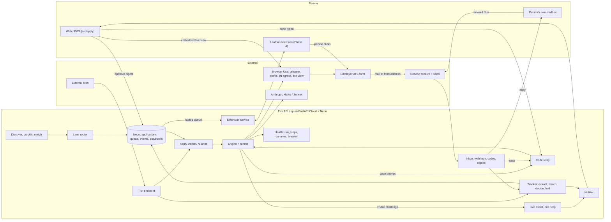
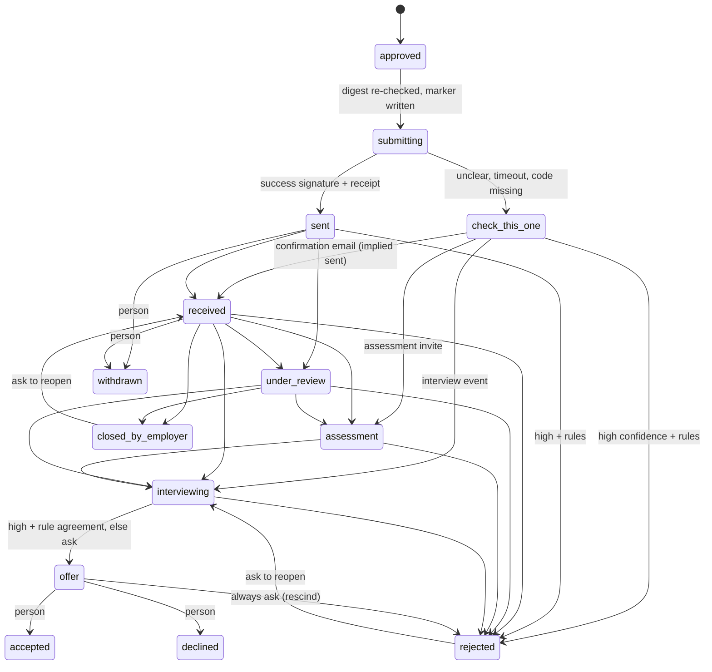

# Leafout end-to-end auto-apply: system design

**Date:** 2026-11-10
**For:** the founder (decisions) and the engineers who will build it
**Status:** input for the design canvas, not an approved spec. CLAUDE.md requires the canvas and the founder's yes first, and specs live in `docs/roadmap.md`.

**How to read the sources.** Code facts point to files in the read-only worktree `Main App/onwardsAi-apply-e2e` (commit 9f468af) or the inbox branch `Main App/onwardsAi-inbox` (`feat/inbound-email`, uncommitted). External facts carry a URL. **(U)** means unverified: the source is a competitor or vendor, a search snippet, or an inference. **(A)** means our own assumption.

**What this design is built from.** It follows the judge's verdict on two candidate designs. The spine is design B (a cloud lane plus a later extension lane, routed per application). Design A supplies the submit mechanics, the code polling, the one-step live view for phone users, the failure taxonomy and the relay Reply-To. Every factual error the judge found has been fixed here; §15 lists the ones that changed the design.

---

## 1. Summary

**What we will build.** Leafout finds roles that fit, fills the employer's own form, shows the person every value with its source, and sends it once after approval. It then follows the application through to an outcome (received, under review, assessment, interviewing, offer, rejected, or "no reply in N weeks") and tells the person only what matters, when it matters. It never solves a CAPTCHA and never sends anything the person did not approve. When a step needs a human (a visible challenge, a code, a login, an account), the person does that step, in as few taps as possible.

**Shape of the system.**

| Part | What it is |
|---|---|
| Lane router | Decides per application, before anything is spent: **Leafout sends it** (cloud), **Finish it with one tap** (cloud with a one-step live assist), **Finish on your laptop** (extension, later), or **Apply on their site** (manual). The card shows the lane. |
| Cloud lane | A1's engine, hardened: a submit browser that lets the employer's *invisible* checks run, an Indian exit IP on the submit pass, a code relay, a fixed post-click challenge detector, receipts, canaries and a circuit breaker. Greenhouse, Lever and Ashby first, then SmartRecruiters, Workable and Keka. |
| Extension lane (later) | The person's own Chrome fills Workday-class forms page by page; the person signs in, creates accounts, solves challenges and clicks Next or Submit. One approval digest per page. |
| Tracking | The inbox branch plus an event model: every email or signal becomes an event, events fold into a stage, unsure or high-stakes changes become one-tap questions. |
| Informing | Push and email now, WhatsApp later. Interviews, assessments and offers immediately; everything else in a 09:00 IST digest. |

**Decisions the founder must make first** (full list in §14):
1. **D1, rule 6 / rule 9: "pass, never solve".** May the approved submit browser load the employer's challenge scripts from page load? Without this, Lever cannot submit at all and Greenhouse probably cannot.
2. **D2, emailed codes.** May the engine type a code sent to the application's email address, and make the one confirming click that follows, inside the same `submitting` marker?
3. **D4, which email goes on the form.** The person's own address (recommended default) or Leafout's tracking address.
4. **D3 + D5, accounts and the extension.** Person-only accounts (recommended), and whether and when to build the extension (recommended: after the cloud lane and tracking, from about week 7).
5. **D7 + D8, proxy and price.** The proxy choice decides whether ₹5 per delivered application has any margin (§11). Decide after the Phase 0 byte measurement.

**First milestone (end of week 1-2).** At least 3 confirmed real submits each on Greenhouse and Lever (and Ashby if D10 allows), using only the founder's own genuine applications, with zero double submits, bytes per submit pass measured, and Indian exit availability known.

---

## 2. Where A1 stands and why runs fail

**Built (about 8,850 lines in `backend/tayyari/apply/`):** start checks, intake with the manual-only list, credit hold/capture/release, a Postgres-leased worker (concurrency 1), Browser Use browsers over CDP with `solveCaptchas: false`, the network guard (preview and submit variants), playbooks for Greenhouse/Lever/Ashby, cited answers, the Haiku-then-Sonnet field loop, pure-code verify, the approval digest, the `submitting` marker, and a paste-only email classifier. Production has **not finished one application**. Fill-only experiments (53 runs, 8 postings) never submitted.

**Production runs on 2026-11-09 (all three failed):**

| Run | Stopped at | Cause | Status |
|---|---|---|---|
| Lever 07:07Z, 20:48Z | `needs_signin` 2 s after open | Lever's invisible hCaptcha (`div.h-captcha`) read as a wall | Fixed in 9f468af (not deployed) |
| Greenhouse 20:44Z | Before click, `resume_not_attached` | Resume upload goes to `grnhse-prod-jben-us-east-1.s3.amazonaws.com`, blocked by the guard | Fixed in 9f468af |
| (latent) Lever | Attach check | Lever shows the file name in capitals; the check was case-sensitive | Fixed in 9f468af |

**What will still stop real sends after 9f468af is deployed:**

| # | Problem | Evidence | Fixed in |
|---|---|---|---|
| 1 | **The guard blocks challenge providers in the submit browser too.** Lever binds `#btn-submit` inside hCaptcha's `onLoad`; without hCaptcha the button has no listener and the click does nothing. Greenhouse ships reCAPTCHA Enterprise (`recaptcha.net/recaptcha/enterprise.js`); a missing token probably means a rejection or an email code (U). | `netguard.py` `CAPTCHA_DOMAINS`; probe of a Lever apply page; [Greenhouse invisible reCAPTCHA](https://support.greenhouse.io/hc/en-us/articles/115005448066) | Phase 0, needs D1 |
| 2 | **Post-click challenge detection is blind on Lever, probably on Greenhouse.** `runner.py:750` sets `before_captcha = blocker_of(...) == "captcha"`; `:814` flags a challenge only when `not before_captcha`. On Lever `div.h-captcha` is always present (`forms.py:182`), so a visible hCaptcha after the click is never detected and ends as a timeout. Once the provider loads, the `hcaptcha.com` iframe (`forms.py:179`) is also present before the click. `_CAPTCHA_BLOCKING` matches only `recaptcha/api2/(anchor|bframe)`; Enterprise challenge frames are probably under `recaptcha/enterprise/` (inferred, U). | code | Phase 0 |
| 3 | **Emailed codes are detected but not consumed.** `_outcome` turns `_CODE_PROMPT` into `check_this_one`; the inbox stores codes (`latest_code`) but nothing calls it. Submit browser timeout is 4 min. | code | Phase 1 |
| 4 | **Datacenter egress.** `proxyCountryCode: None`; Greenhouse Fraud Detection names a data-center IP as high risk; Ashby flags location mismatch. | [Greenhouse Fraud Detection](https://support.greenhouse.io/hc/en-us/articles/42738009117467-Fraud-Detection), [Ashby fraud detection](https://docs.ashbyhq.com/candidate-fraud-detection) | Phase 0 measure, Phase 1 build |
| 5 | **Unproven success signatures and hosts** (Ashby submit/upload hosts, EU Greenhouse bucket). | code comments | Phase 0 |
| 6 | **Operations:** concurrency 1 inside a web app that FastAPI Cloud may pause when idle; no scheduler; rows stuck in `needs_signin` still hold credits (the 402 one user saw). | `worker.py`, diagnosis | Phase 0-1 |
| 7 | **Coverage:** Workday and every login-first ATS refused at `checks.evaluate_start`; discovery (`discover/registry.py`, `jobsearch/harvest.py`) only yields Greenhouse and Lever. | code | Phase 4 |

---

## 3. What Tsenta and others do

| Product | Apply engine | CAPTCHA | Accounts | Email and tracking | Notable |
|---|---|---|---|---|---|
| **Tsenta** (YC S26) | Cloud: "the submission itself runs in Tsenta's cloud workflow" ([docs](https://docs.tsenta.com/product/apps-and-surfaces)); extension only queues the role | Not stated; "handles supported account and verification steps" ([docs](https://docs.tsenta.com/product/how-auto-apply-works)) | **Creates Workday/iCIMS/Oracle accounts** with one stored password and its own mailbox (our teardown §1, §9; [YC](https://www.ycombinator.com/companies/tsenta)) | Hosted inbox on every application; Gmail/Outlook for OTPs; labels Verification, Rejection, Interview, Recruiter, Assessment, Reminder, Offer, Applied; kanban with Ghosted | $19/600, $39/1,500, $99/4,500 a month ([pricing](https://tsenta.com/pricing)). Review pause on 6 ATSs; Auto Apply skips review ([changelog](https://tsenta.com/changelog)). Teardown: charged before the live check, uploaded the resume before approval, answered US work authorisation "Yes" from an India-only fact |
| **Simplify** | Copilot: extension, person submits. Autopilot: submits for them (where it runs not public) | Not stated | Proxy address takes one-time codes | Proxy `@resend.letterfern.com` forwards non-code mail to the person ([help](https://help.simplify.jobs/articles/0236686-email-integration)); Gmail integration **suggests** status changes, person approves | Approve/decline status suggestions are the only public admission a classifier can be wrong |
| **Jobright** | Autofill extension; Agent submits (waitlist, U) | "If a site explicitly blocks bots, it directs the job seeker to apply manually" ([The Register](https://www.theregister.com/2025/06/24/ai_may_take_jobs_but/)) | Not stated | Follow-up reminders | |
| **Massive** | Cloud | Not stated | Applies under a Massive-made address (U) | Proxy mailbox (U) | Trustpilot 1.7; same job applied 100+ times; invented "does NOT require sponsorship" ([via Scoutify, U](https://scoutify.com/blog/massive-review/)) |
| **Scoutify** | Cloud on GH, Workday, SmartRecruiters, Ashby, Lever; **alerts only** for iCIMS/Taleo | Not stated | — | Own mailbox that **forwards everything** to the person | Self-reported |
| **JobWizard** | Hand-off: person passes login and CAPTCHA, autofill runs, person submits | Person | Person | — | Its mix: 65% Workday ([blog](https://jobwizard.ai/blog/why-auto-apply-tools-fail-on-captchas-and-login-screens)) |
| **Aplyr** | — | — | — | Reads codes from Gmail or `@inbox.aplyr.co`; "the application may pause instead of submitting" if no code ([help](https://help.aplyr.ai/articles/6666883-how-verification-codes-work)) | |
| **scale.jobs** | Human VAs in India | Humans | Humans | Screenshot per application on WhatsApp ([pricing](https://scale.jobs/pricing.md)) | |
| **LazyApply** | Extension driving the person's LinkedIn | — | Person's board login | Count only | LinkedIn ban anecdotes (U) |
| **Naukri Neo** | Inside Naukri (no CAPTCHA, no ToS problem) | n/a | n/a | Naukri's own | The direct Indian competitor; Leafout cannot automate Naukri ([page](https://www.naukri.com/naukri360/neo-auto-apply-job-agent), 403 to our fetch) |

**Market facts that shape the design.** No consumer product publicly claims to solve CAPTCHAs, but Browser Use solves them by default ([captcha doc](https://docs.browser-use.com/cloud/browser/captcha-handling.md)), so products on it may be solving silently. ATSs now score exactly what a cloud bot looks like: Greenhouse (data-center IP, spam flag that auto-rejects that email at that employer for good: [Mark as spam](https://support.greenhouse.io/hc/en-us/articles/205094045-What-does-the-Mark-As-Spam-button-do-)), Ashby (device, IP, email, phone), Workable ("AI-assisted" tag, [help](https://help.workable.com/hc/en-us/articles/35293126257815-Managing-AI-generated-and-automated-job-applications)).

**Copy:**
- A receipt per application (fields, resume version, time, success screenshot) — Tsenta, scale.jobs.
- Status changes as suggestions the person approves — Simplify.
- A missing code pauses rather than fails — Aplyr.
- Any Leafout address forwards everything to the person — Scoutify.
- Surface hard portals honestly, with "I applied" — LoopCV, Tsenta's Not Supported screen.
- Dedupe by requisition; gate on hard facts (work authorisation per country).
- Apply early to fresh postings — Tsenta, Naukri Neo. Early matters; volume does not.
- WhatsApp for "needs you" and stage changes (India).

**Avoid:**
- Charging before the live check; charging for a send without a confirmation signal.
- Auto-submit without review; volume as the metric.
- Machine-solving CAPTCHAs, by default or otherwise.
- Stored ATS passwords and Leafout-owned login emails (lock-in; Sonara lost user data at shutdown).
- A US proxy for Indian applicants (Browser Use's default).
- Driving job boards through the person's session.
- Billing dark patterns.

---

## 4. The end-to-end journey

| Step | What the person sees | What the system does |
|---|---|---|
| 1. Set up (5 min) | Profile, resume, answer bank, work authorisation per country, self-ID defaults to decline. Consent `apply-v2` naming every processor. Choose email on forms (D4). Optional: Gmail forward filter wizard (desktop) or tracking address. Notification channels. | Creates the per-user Browser Use profile on first submit. Inbox address if opted in (`inbox-v1`). |
| 2. Find | Discover, Search with AI, pasted links; later a daily "Ready for you" stack. Each card shows its **lane** before anything is spent. | `quickfit` (code only), then the full match on the shortlist; hard-requirement gates; `choose_lane`. Pre-fills are capped per day (pre-fill spend is real money even if never approved). |
| 3. Preview | "Filling…", then a Review: every value, its source, open questions. | Preview browser: ephemeral (no persistent profile), direct egress, guard `preview` variant (no writes, no challenge providers, no resume upload). Builds the review script and the digest. |
| 4. Approve | Answers questions; approves the digest. Batch approve allowed, one digest per application. | Writes `approved` with the digest. |
| 5. Send | "Sending…". If a code is needed: "Enter the code Greenhouse just sent you" (CodePrompt), or nothing if the code arrives in the tracking inbox. If a visible challenge appears: "Acme needs you (about 1 min)" with a one-step live assist. | Submit browser created **with the `submit+challenge` guard variant**, the persistent profile and IN egress, only for this approved row whose stored digest matches. Replays with no model, re-checks the digest, `submitting` marker, one click, outcome poll. |
| 6. Confirmed | "Sent" with a receipt; credit captured. | Success signature + screenshot → `sent`; confirmation email → `received`. Unclear → `check_this_one`, never a retry. |
| 7. Honest failure | "Couldn't send. Finish it on Acme's site and tap I applied." Nothing charged. | Hold released; tracking continues via "I applied". |
| 8. Track | Board: Sent → Received → Under review → Assessment → Interviewing → Offer; terminal Rejected, Withdrawn, Accepted, Declined, Closed. A "No reply in 3 weeks" flag. Ask cards: "Which application?", "Did Acme reject you?" | Emails, ICS invites, posting-status polls and the person's own updates become events; `stages.fold`; asymmetric gates. |
| 9. Informed | Immediate push/email for interview, assessment deadline, offer, needs-you. Daily 09:00 IST digest for the rest. Rejections never pushed alone or at night. | Notifier with quiet hours 22:00-08:00 IST and a cap of about 5 pushes a day. |
| 10. Later: laptop lane | "Finish on your laptop, ~3 min" for Workday-class forms. | Extension fills page by page; person clicks; one digest per page (§6.4). |

---

## 5. Architecture

**Components** (paths under `backend/tayyari/` unless they start with `src/`, `shared/` or `extension/`):

| Component | Responsibility | Code location | New / changed |
|---|---|---|---|
| Discovery | Boards, AI search, quickfit, match, hard gates; later a watcher for new postings and the Ready stack | `discover/` (`quickfit.py`, `refresh.py`, `registry.py`), `jobsearch/`, `match/`; later `apply/watch.py` | Changed later (Ready stack, Phase 4) |
| Lane router | Pure `choose_lane(app, playbook, ats_prior, employer_stats, devices) -> Lane`; stored as `lane`, `lane_reason` | new `apply/lanes.py`, called from `apply/checks.py` `evaluate_start` and on every stop | New |
| Start checks | `own_account_ats` routes to extension/manual instead of refusing | `apply/checks.py` | Changed |
| Worker | Lease rows; concurrency N≈5 (Browser Use tier 0 allows 10, [pricing](https://browser-use.com/pricing.md)); one active browser per user; never requeue a submit | `apply/worker.py`, `apply/wake.py` | Changed |
| Tick | Worker sweep, posting-status poll, no-reply flags, reminders, digests, health email; called by an external cron with a secret the founder sets | new `api/routes/internal.py` | New |
| Engine and runner | Stage moves, spend, preview, submit, outcome poll, code wait, assist pause | `apply/engine.py`, `apply/runner.py` | Changed |
| Browser adapter | `profileId` on submit only, `proxyCountryCode: "in"` (or BYO `customProxy`) on submit only, keep `liveUrl` as a credential, per-profile timeouts, `solveCaptchas: false` asserted in a test | `apply/browser_use.py`, `apply/browser.py`, `apply/driver.py` | Changed |
| Guard | Two variants baked in at browser creation: `preview` (blocks writes and providers) and `submit+challenge` (provider *scripts* allowed per `challenge_profile`, providers never receive writes via `norm_write_hosts`) | `apply/netguard.py` | Changed |
| Challenge detection | Detect a *visible* challenge (frame bounding box or challenge-frame URL), not the provider's marker | `apply/forms.py` (`blocker_of`, `_CAPTCHA_BLOCKING`), `apply/runner.py` (~l.750, ~l.814) | Changed |
| Playbooks | `challenge_profile` replaces `captcha_on_submit`; hosts learned from canaries; new SmartRecruiters, Workable, Keka playbooks | `apply/playbook.py`, `ats_playbooks` table | Changed |
| Code relay | Poll `inbox.latest_code` every 5 s for 10 min after a code prompt; accept a person-typed code; type it, one confirming click, `mark_used` | `apply/runner.py` `_outcome`; `inbox/codes.py`, `inbox/service.py`; route in `api/routes/apply.py`; `src/apply/CodePrompt.tsx` | New |
| Live assist | One-step live view for a visible challenge or a code on GH/Lever/Ashby; re-digest on return | new `apply/assist.py` (not `handoff/`, which is the marketing-site hand-off), route in `api/routes/apply.py`, `src/apply/AssistView.tsx` | New |
| Extension service | Pairing, laptop queue, plan per page, page digests, outcome | new `apply/ext.py`, `api/routes/ext.py`, `extension/` (MV3, TypeScript, shares `shared/apply.ts`) | New, Phase 4 |
| Inbox | Per-user address, Svix webhook, codes (15-min TTL), tier-aware copies, relay Reply-To, header/ICS parsing (transient), Gmail forward-confirmation surfacing | `inbox/*`, `api/routes/inbox.py`, `contract/inbox.py`, `shared/inbox.ts` (branch `feat/inbound-email`) | Merge, then change |
| Tracker | Extract (Haiku, quotes verified), match (code), decide (gates), fold | `apply/email.py` split into `apply/track/{extract,match,decide}.py`; `apply/stages.py` `fold` | Changed |
| Notifier | Web push (PWA service worker), email via Resend, WhatsApp later; reached from `apply` through `apply/seams.py` (layering rule) | new `notify/`; `src/` service worker; `src/apply/NotificationSettings.tsx` | New |
| Health | `run_steps` funnel, canaries, circuit breaker, `apply_run_done`, daily health email | `apply/metrics.py`, new `apply/canary.py`, `api/routes/apply.py` metrics | Changed |
| Contract | New stages, stop reasons, ATS kinds, events | `contract/apply.py`, `shared/apply.ts` | Changed |
| Storage | Additive migrations 0019+ (after inbox 0018) | `storage/` migrations, `storage/ports.py`, `storage/repos/` | Changed |
| Frontend | LaneBadge, CodePrompt, AssistView, ReceiptView, stage board with ask cards and timeline, notification settings; later LaptopQueue, DevicesView, ReadyStack | `src/apply/` (`ApplicationsView.tsx`, `ReviewView.tsx`, `NeedCard.tsx`, `OutcomeView.tsx`, new files) | Changed |

**Layering rule kept:** `apply` never imports `billing`, `guard` or `match`; notifier, watcher and spend go through `apply/seams.py`.

---

## 6. Apply engine

### 6.1 Coverage strategy per ATS

Shares are estimates for postings an Indian tech candidate would want (coverage research §1.2; confidence medium/low). The best hard data, 135 Indian startups in [job-radar](https://github.com/aspiringDev22/job-radar), counts companies not postings and misses Darwinbox, SuccessFactors and own portals by construction.

| ATS | Share (est.) | Lane / engine | Challenge type (`challenge_profile`) | Account needed | Plan |
|---|---|---|---|---|---|
| Greenhouse | 12-18% | Cloud playbook | `invisible_score` (reCAPTCHA Enterprise) + `email_code_conditional` | No | Phase 0-1 |
| Lever | 5-8% | Cloud playbook | `invisible_on_submit` (hCaptcha bound to the submit button) | No | Phase 0-1 |
| Ashby | 3-6%, rising | Cloud playbook | `invisible_score` (reCAPTCHA, migrating to Enterprise); fraud detection on device/IP/email/phone | No | Phase 0-1, subject to D10 |
| SmartRecruiters | 3-5% | Cloud playbook | `invisible_score` (reCAPTCHA v3) | Mostly no (U) | Phase 4a |
| Workable | 1-3% | Cloud playbook, or extension if Turnstile blocks | `turnstile`; tags "AI-assisted"; **replaces system-generated emails with the resume email** | No | Phase 4a; own email only (tracking address breaks here) |
| Keka | 2-5% | Cloud playbook | Unknown (probe first) | Unverified | Phase 4a |
| Workday | 20-30% | **Extension**, per-page digest; never cloud preview (the guard blocks Save-and-continue POSTs, so a cloud preview cannot pass page 1) | `edge_bot_mgmt` (Cloudflare `__cf_bm`) + `account_required` | Yes, per tenant ([admin guide](https://doc.workday.com/admin-guide/en-us/human-capital-management/recruiting/career-sites/gtv1538650489786.html)) | Phase 4b, after week 6; needs a discovery source (D11) |
| SuccessFactors | 5-10% | Extension | `account_required`; optional CAPTCHA on login/creation ([SAP KB](https://userapps.support.sap.com/sap/support/knowledge/en/2082087)) | Usually | Phase 4c |
| Oracle / Taleo | 4-8% | Extension | `email_code_always` (6 digits); hCaptcha optional ([Oracle](https://docs.oracle.com/en/cloud/saas/talent-management/faimh/enable-hcaptcha.html)) | Code-verified profile | Phase 4c |
| Darwinbox, iCIMS, Zoho | 1-10% each | Extension or manual | `account_required` (mostly U) | Usually | Phase 4c+, measure first |
| Custom portals (TCS, Infosys, Amazon…) | 10-20% | **Manual** with a copy sheet of approved answers | Varies; mostly login-first | Usually | No generic navigator in this plan (low value per effort; the guard blocks the POSTs it needs) |
| LinkedIn, Naukri, Indeed… | most volume | Manual, never fetched | n/a | n/a | Never (rule 4) |

Measure instead of guessing: add a `destination_ats` counter wherever an apply link is seen (extend `apply/intake.py` `fingerprint_url` with the host patterns from the coverage research) and report the share weekly.

### 6.2 Fill strategy (both lanes, cheapest first)

| Tier | Method | Measured |
|---|---|---|
| 1 | Playbook replay | 5/6 full success, $0.0007 |
| 2 | Answer bank, then cited Haiku answers (high confidence only; eligibility, salary, notice, demographic, consent never drafted) | as built |
| 3 | Field-list loop: Haiku ≤4 rounds, then one Sonnet round, pure-code verify | Haiku 4/8, Sonnet 6/8 |
| 4 | The person (never-stored fields, walls, challenges) | — |

**Never** the Browser Use agent API: V4 agent runs cannot turn off CAPTCHA solving (`experiments/auto_apply/RESULTS.md`) and overclaimed fills. Known fill fixes: read section headings in the scanner, add education to the profile, react-select/typeahead strategies, cookie banner or "Apply" button as a playbook `open_texts` step.

### 6.3 Cloud submit, step by step (corrected)

The guard is a Manifest V3 declarativeNetRequest extension whose variant is fixed when the browser is created (`netguard.py`). So the correct mechanism is to **create the submit browser with the `submit+challenge` variant**, never to switch mid-session.

1. Worker leases an `approved` row. **Pre-condition checked in code before `create_browser`:** stage is `approved`, the stored digest exists, and the review script hashes to it. Only then is a `submit+challenge` browser created (persistent per-user profile, IN egress, 15-min timeout for code-profile ATSs, else 4 min).
2. `goto`. The provider scripts load with the page, as in any real browser (Lever's `onLoad` binds `#btn-submit`; Greenhouse loads `enterprise.js`). The engine never touches a challenge frame.
3. Stop check (login wall, closed text; a visible challenge here stops before anything is sent → assist or manual).
4. Replay the review script with **typed input and dwell** (real key events, seconds of cost). One retry for drifted fields.
5. Digest check; submit-button and submit-host checks; resume-name check (case-insensitive).
6. `mark_submitting()`. Allow submit and upload hosts. Upload; wait for the file name; replay `_drifted()` fields from the script with no model.
7. Re-digest. **Click once.**
8. Outcome poll:
   - Success URL/text → screenshot → `sent` + receipt.
   - Code prompt → code relay (§7.3): one code entry and one confirming click, within the same marker, never repeated (D2).
   - **Visible** challenge (frame visible with a non-trivial bounding box, or an hCaptcha challenge frame / reCAPTCHA `bframe` under `api2` or `enterprise` paths) → one-step live assist, marker kept.
   - Error text, timeout or anything unclear → `check_this_one`. Never an automatic retry.

**Never:** `solveCaptchas: true`; any solver; pressing Enter to fire Lever's hidden `#hcaptchaSubmitBtn` and skip hCaptcha.

**Preview vs submit identity.** Running the preview on datacenter egress and the submit on an Indian IP with the *same* profile makes one cookie jar jump countries within minutes. Design: the **preview uses an ephemeral browser with no profile**; the **persistent profile is used only by submit browsers, always on the same egress type**. Browser Use randomises fingerprints per session ([stealth](https://docs.browser-use.com/cloud/browser/stealth.md)); whether a profile pins the fingerprint is U. Phase 0 compares "fresh session" against "persistent profile" on challenge rate before committing.

### 6.4 Extension lane (Phase 4)

- MV3 extension (A: MV3 forbids remotely hosted code), so playbooks ship as **declarative JSON** interpreted by a bundled TypeScript scanner/filler/verify (ports of `scan.py`, `forms.py`, `verify.py`); `/api/ext/playbooks?since=v` updates them without a store release.
- Per page: content script sends structure only (labels, types, options, required) → `POST /api/ext/plan` → backend runs `answers.plan_fields` under `SpendGuard` → extension fills, verifies, shows the side-panel review.
- **One digest per page** (Workday's Save-and-continue posts data on every page, so per-page approval is the only honest reading of "nothing reaches the employer before approval"). A **capture-phase click listener** on the employer's Next/Submit recomputes the page digest; if it differs from the approved one, the click is held and the person re-approves the page. This keeps rule 9's "re-checked just before the click"; it is still a founder decision (D5).
- Pauses on any challenge frame, password field or sign-in form; never reads, fills or clicks inside them. The person signs in, creates accounts and clicks Submit.
- Host permissions: known ATS hosts only (`*.myworkdayjobs.com` etc.) as optional per-ATS permissions. No arbitrary corporate career sites (broad host access slows Chrome Web Store review and is a trust ask).
- Desktop only: India web traffic is about two-thirds mobile ([StatCounter](https://gs.statcounter.com/platform-market-share/desktop-mobile-tablet/india)) and Chrome for Android has no extensions.

---

## 7. Challenges: CAPTCHA, login, email codes, accounts

### 7.1 Rule 6 as a decision (D1)

Today, spec rule 6 says "No CAPTCHA solving, no logging in for the person… the guard blocks challenge providers", and CLAUDE.md rule 9 says "Never solve or bypass a CAPTCHA or log in for the person". Read literally, blocking the provider makes sending impossible on Lever and probably on Greenhouse.

| Option | What it means | Effect |
|---|---|---|
| **A. Keep rule 6 as written** | Providers stay blocked in every browser | Lever never submits; Greenhouse probably gets no token → rejection or code (U). Cloud lane covers Ashby at best. Everything else manual or extension. |
| **B. "Pass, never solve" (recommended)** | Approved submit browsers load the employer's challenge scripts from page load; nothing machine-solves a visible challenge; visible challenges, logins and accounts go to the person | Unblocks Lever and Greenhouse; keeps Leafout's no-solving line, a real differentiator |
| C. Let Browser Use solve (`solveCaptchas: true`) | Vendor solves silently, no event or audit trail | Circumvention; spam/fraud flags fall on the applicant; refused |

Proposed replacement text (for `docs/auto-apply.md` §1 rule 6 and CLAUDE.md rule 9):

> **Pass, never solve.** No machine solves a visible CAPTCHA: browsers are created with `solveCaptchas: false`, no solver service is used, and agent runs that cannot disable solving are not used. Preview browsers block every challenge provider. A submit browser is created with the employer's challenge scripts allowed only for an application the person approved and whose stored digest matches, so invisible checks run as they do in any real browser; the providers never receive form data. A visible challenge, login or account step goes to the person; Leafout never clicks or types inside a challenge widget. A one-time code sent to the address on the application may be typed by the engine, followed by one confirming click, within the same submitting marker and never repeated (D2).

Why this line holds: loading an invisible scoring script is what every browser does; defeating a visible control is the clearest "without permission" fact pattern under IT Act s.43(a) ([text](https://cis-india.org/internet-governance/resources/section-43-it-act.txt); reading U, needs counsel). Solvers do not list hCaptcha at all ([2Captcha](https://2captcha.com/pricing), [CapSolver](https://www.capsolver.com/)). **Before shipping:** one live fill-only test with the provider loaded, stopping before the click, to confirm a token is minted.

### 7.2 Options for passing challenges

| Option | Risk (legal / applicant / Leafout) | Cost per application | Effort | Recommendation |
|---|---|---|---|---|
| (a) Avoid triggering: per-user profile, IN egress on submit, pinned locale/timezone, typed input, low velocity, providers allowed on submit | Low / low / low (IN only; never a foreign IP) | Direct ₹0; BYO ISP ≈ ₹0.2-1; managed residential ₹2-7 (bytes unmeasured, [pricing](https://browser-use.com/pricing.md)) | 3-6 days | **Default for every cloud submit** |
| (c) One-step live assist via Browser Use live view | Low (a human solves it) / low / live URL is a bearer credential | ≈ $0.0033 per 10 min held ($0.02/h) | 5-8 days | **Phone fallback**, GH/Lever/Ashby, one step only (visible challenge or code) |
| (b) Extension in the person's Chrome | Low / lowest (their IP, cookies) / Chrome Web Store dependency | ≈ model only, ₹0.1-2 | 3-5 weeks + store review; second engine to maintain | **Workday-class lane, Phase 4** |
| (d) Browser Use `solveCaptchas: true` | High: circumvention, no audit trail | "Included" | Trivial | **Never** |
| (e) 2Captcha / CapSolver / Anti-Captcha | High: circumvention, offshore sub-processor, "Mark as spam" auto-rejects that email at that employer | $0.8-3 per 1,000 | Low | **Never** |

**Velocity caps.** Keep 10 a day per person and 6 an hour per employer domain. A per-IP-per-employer-per-day cap **cannot be enforced on Browser Use's managed proxy**, which guarantees neither a sticky nor a unique IP ([proxies](https://docs.browser-use.com/cloud/browser/proxies.md)). Enforce it only on a BYO ISP pool where Leafout assigns IPs; on managed egress, record the observed egress IP per run (read via an IP-echo GET inside the submit browser, allowed by the guard) for telemetry only.

### 7.3 Email codes

| Situation | Email on the form = person's own | Email on the form = tracking address |
|---|---|---|
| Greenhouse conditional code after the click | Push + **CodePrompt** (person types it within 10 min); automatic if their Gmail forward filter is on | `latest_code` polled every 5 s for 10 min, automatic |
| No code within 10 min | One-step live assist if the person opens it; else `check_this_one` ("may already be sent") | same |
| Oracle (always a code) | Extension lane | Extension lane |
| Verification *links* | Never opened by Leafout | Stored, not opened (no link policy built) |

The confirming click after the code is the **second click** of that submit. Rule 9 ("a submit is never retried automatically") needs an explicit carve-out: one code entry and one confirming click, within the same `submitting` marker, never repeated (D2).

### 7.4 One-step live assist (Phase 3)

- Triggers: a visible challenge after the click, or a code that did not arrive, on GH/Lever/Ashby only. Not Workday (that is the extension lane).
- `create_browser` keeps `liveUrl`, never logged. The person opens an authenticated, single-user page `/apply/assist/<id>` that embeds the live view in a sandboxed iframe (`frame-src live.browser-use.com`). **The URL necessarily reaches the person's own client**; the honest controls are: short-lived browser, fetched per view, never cached, single-user authenticated page, browser stopped with `PATCH {"action":"stop"}` on completion or at 30 min ([live preview](https://docs.browser-use.com/cloud/browser/live-preview.md), [human-in-the-loop](https://docs.browser-use.com/cloud/agent/human-in-the-loop.md)). `readOnly` is UI-only, not enforced.
- On return: rescan, re-verify, **recompute the digest**; any changed value means the row goes back to Review. Copy says the person is acting on the employer's page.
- Risks: phone usability of a desktop-size live view is U; test on Android. Passwords typed in it may persist in the profile, so the assist is never used for sign-in in this plan.

### 7.5 Accounts (D3)

| Option | Person's effort | Tracking value | Risk | Recommendation |
|---|---|---|---|---|
| A. Person creates and holds accounts (extension lane) | 1-3 min per tenant, once | Low (no portal reads) | Lowest; fits rule 9 and project-soul | **Now** |
| B. Leafout creates accounts with the person's email and a vaulted password (KMS envelope encryption) | None except verification | High | Credential liability; changes project-soul; needs counsel | Not before Phase 5, only if D3 says yes |
| C. Same with the tracking address as login email | None | Highest | Lock-in (Sonara precedent), shared-domain risk | No |
| D. Skip account ATSs | — | — | Loses ~30-50% of relevant postings | Interim only (manual lane until Phase 4) |

**Candidate Home / MyGreenhouse status reads (D12):** recommended **no**. It means reading the person's account, which project-soul refuses ("No scraping of people's accounts").

---

## 8. Tracking and stage identification

### 8.1 Sources

| # | Source | Gives | How | Phase |
|---|---|---|---|---|
| S1 | Success page + receipt | sent | engine (exists) | have |
| S2 | ATS confirmation email | received | form address mail | 2 |
| S3 | ATS status templates | under_review, rejection, self-schedule | form address mail | 2 |
| S4 | Recruiter mail to the form address | interview, info request, offer, rejection | form address mail | 2 |
| S5 | Calendar invites (`text/calendar`) | interview time, reschedule, cancel ([RFC 5545](https://www.rfc-editor.org/rfc/rfc5545), [RFC 5546](https://www.rfc-editor.org/rfc/rfc5546)) | parse the MIME part **transiently inside `process()`**, store only structured fields (UID, SEQUENCE, DTSTART, METHOD); Resend attachment URLs expire after 1 h ([Resend](https://resend.com/docs/dashboard/receiving/attachments.md)); keeps the no-attachments rule | 2 |
| S6 | Assessment platforms | invite + deadline | sender domains learned, not hard-coded | 2 |
| S7 | Scheduling tools | interview request | link host | 2 |
| S9 | Public posting status (Greenhouse/Lever/Ashby APIs by `posting_key`) | role_closed hint | daily tick | 2 |
| S12 | The person: manual moves, ask answers, "Log an update" (phone and WhatsApp calls, common in India) | anything | UI | 2 |
| — | Candidate portals | — | **not read** (D12) | — |

**How mail reaches Leafout depends on D4:**
- Own email on the form: a Gmail filter forwarding ATS senders to the person's tracking address. Gmail sets up forwarding only on desktop web, not in the app, and sends a confirmation code **to the forwarding address**, i.e. into Leafout's inbox ([university guide 1](https://kb.mlml.sjsu.edu/books/g-suite/page/configure-forwarding-in-gmail), [guide 2](https://help.georgetown.edu/support/solutions/articles/16000007597); not Google's own docs). `codes.extract` keeps only codes near ATS wording and never shows codes, so **the inbox must special-case Gmail's forwarding-confirmation mail and show that code to the person in the setup wizard**, or setup can never finish. Forwarded mail may arrive late and whether `Message-ID`/`References` survive is U. Phone-only users get paste and "Log an update" instead.
- Tracking address on the form: complete capture, but Workable replaces it with the resume email, Greenhouse never lets it change, and one employer blocking `@apply.leafout.in` hits every user.
- Blind spot either way: recruiters writing to the resume address. Measure via the no-reply nudge ("did anyone contact you about X?").

### 8.2 Matching an email to an application

| Step | Rule | Score |
|---|---|---|
| User | Local part of the tracking address | — |
| Thread | `In-Reply-To`/`References` in `email_threads` | 1.0 |
| Requisition id | exact match against `posting_key` | 0.98 |
| Workday tenant | sender local part = tenant in apply URL, and title similarity ≥ 0.6 (equality U) | 0.95 |
| Otherwise | sender domain in `employer_domains` 0.45 + word-boundary company match 0.30 (fixes "Meta"/"metadata", `email.py` l.200) + title similarity × 0.20 + time prior 0.05; `Date` must be after `submitted_at` | weighted |
| Decision | auto-attach ≥ 0.85 with margin ≥ 0.20; ask ≥ 0.40; else unmatched | |
| Multi-application email | `EmailClassification.matches[]` | |

The model only **extracts** `{event_type, company, title, req_id, dates, deadline, quotes[]}`; code verifies every quote (keep `email.py` l.180) and decides. Thread continuity: the inbox copy's Reply-To becomes a relay `r-<token>@apply.leafout.in` that re-sends from the tracking address keeping `In-Reply-To`/`References` (today it is the employer, which moves the thread out of sight).

### 8.3 Taxonomy

**Events** (many per application, append-only): `confirmation`, `under_review`, `info_request`, `assessment_invite|reminder|completed`, `interview_request|scheduled|rescheduled|cancelled|reminder|feedback_next_round`, `offer`, `offer_process`, `rejection`, `role_closed`, `on_hold`, `withdrawal_confirmed`; non-stage: `verification_code`, `account_notice`, `marketing`, `unrelated`.

**Stages** (derived): ranked `sent`(0) → `received`(1) → `under_review`(2) → `assessment`(3) → `interviewing`(4) → `offer`(5); terminal `rejected`, `withdrawn`, `accepted`, `declined`, `closed_by_employer` (reopenable). `viewed` becomes an alias of `under_review`; `needs_signin` an alias of `needs_you`. The stage column is a string, so no DDL.

**"Ghosted"** is a derived flag `no_reply_since`, shown as "No reply in N weeks" (Leafout already decided against the word; Tsenta uses it).

**Fold rules.** `stages.fold(events)` is pure, sorts by `occurred_at` (email `Date` or ICS `DTSTAMP`, not arrival), never regresses rank (backward events are logged only), and `stages.move` stays the single compare-and-set writer. A permutation test proves out-of-order safety. Interview cancel/reschedule changes the `interviews` row, not the stage.

### 8.4 Confidence gates and asks

| Class \ match | Auto (≥0.85, margin ≥0.2) | Ambiguous | None |
|---|---|---|---|
| High | apply + notify | ask "Which application?" | unmatched; ask only for offer/interview |
| Medium | low-stakes events only (confirmation, under_review, assessment, interview_request); **ask** for offer/rejection | ask if high-stakes | inbox list |
| Low | timeline only | inbox list | inbox list |

`pending_questions` (`which_application | confirm_event | reopen`): at most about 3 open per person, expire after 14 days, every answer becomes a label.

### 8.5 No-reply thresholds (stored as data, re-fit monthly with Kaplan-Meier on Leafout's own response times)

| Situation | Threshold |
|---|---|
| Default (sent / received / under_review) | 21 days since the last signal |
| Workday, Oracle, SuccessFactors, large tenants | 30 days |
| Ashby, Lever, small Greenhouse boards | 14 days |
| Assessment invite, no follow-up | 10 days after its deadline |
| Interviewing | follow-up nudge at 7 business days; flag at 21 days |

Set by the daily tick; today's UI-only "sent + 21 days" goes away. These numbers are product judgement (U).

### 8.6 Notifications

| Tier | Events | Channel |
|---|---|---|
| Now | interview (any change), assessment invite/deadline, info request with deadline, offer, needs-you (code, assist), high-stakes ask | Web push (PWA) + email; WhatsApp later (opt-in, template approval, pricing U) |
| Reminders | assessment −24 h, −3 h; interview −24 h, −1 h | push |
| Daily digest 09:00 IST | received, under review, rejections (never pushed alone or at night), no-reply flags, follow-up drafts, low-stakes asks | email / in-app |
| Silent | duplicates, codes, marketing | timeline |

Quiet hours 22:00-08:00 IST except items due within 24 h; at most about 5 pushes a day; `notifications.event_key` unique. iOS web push needs the PWA on the home screen (U).

### 8.7 Accuracy measurement

- **Labels:** ask answers and corrections within 7 days (free); pastes; a **donated, anonymised set** under its own consent (D13), kept out of production in `backend/tests/fixtures/emails/`; synthetic templates for rare classes (coverage tests only).
- **Within 6 weeks:** about 100 donated emails plus **shadow mode** (events recorded, stage changes shown as Simplify-style suggestions the person approves, which also produces labels). Production has sent nothing yet and the cap is 10 a day, so 500 labels in 6 weeks is not reachable.
- **Gate before automatic stage moves are switched on:** ≥ 500 real labelled emails, ≥ 30 per event type, stratified by ATS and sender kind.

| Metric | Target |
|---|---|
| False offer | < 0.5% |
| False rejection | < 1% |
| Interview + assessment recall | ≥ 98% |
| Wrong auto-attach | < 1% |
| Ask rate | ≤ 10% |

CI fails on any regression over the fixture set. Once 3 person-confirmed labels agree on a template, label it in code with no model call.

---

## 9. Data model changes

Additive migrations from 0019 (after inbox 0018).

| Table | New / changed | Key columns | Phase |
|---|---|---|---|
| `applications` | + columns | `lane`, `lane_reason`, `challenge_profile`, `applied_email`, `applied_via` (own/tracking), `company_domain`, `ats_tenant`, `egress_kind`, `last_signal_at`, `no_reply_since`, `receipt_id` | 0-2 |
| `browser_profiles` | new | `user_id` PK, `bu_profile_id`, `created_at`, `last_used_at`, `status`, `deleted_at` (a profile is a credential) | 1 |
| `run_steps` | new | `run_id`, `step`, `ok`, `reason`, `ms`, `ats`, `employer_domain`, `lane` | 1 |
| `challenge_observations` | new | `run_id`, `ats`, `employer_domain`, `lane`, `phase` (load/pre-click/post-click), `kind`, `visible`, `egress_kind`, `egress_ip_hash`, `outcome` | 0-1 |
| `receipts` | new | `application_id`, `fields_sent` (from the review JSON), `resume_sha256`, `screenshot_key`, `success_signal`, `sent_at` | 1 |
| `ats_playbooks` | + columns | `challenge_profile`, `version`, `status` (draft/shadow/active/retired), `breaker_state`, `breaker_until` | 1 |
| `canary_postings` | new | `ats`, `url`, `posting_key`, `active`, `last_run_at`, `last_outcome` | 1 |
| `assists` | new | `id`, `application_id`, `kind` (challenge/code), `browser_id`, `opened_at`, `resolved_at`, `outcome`, `digest_changed` (never the live URL) | 3 |
| `application_events` | + columns | `occurred_at`, `event_type`, `confidence`, `external_key`, `inbound_email_id`, `lane`; unique `(application_id, source, event_type, external_key)` | 2 |
| `inbound_emails` | + columns | `in_reply_to`, `references[]`, `date_header`, `fingerprint`, `event_type`, `class_conf`, `match_conf`, `match_features` (still no body) | 2 |
| `email_threads` | new | `(user_id, message_id) → application_id` | 2 |
| `interviews`, `assessments` | new | ICS UID/SEQUENCE/start/end/status; platform/deadline/status | 2 |
| `employer_domains`, `sender_rules` | new | global, no personal data | 2 |
| `pending_questions`, `notifications`, `push_subscriptions`, `ghost_thresholds` | new | as §8 | 2 |
| `application_pages` | new | `application_id`, `page_no`, `digest`, `approved_at`, `sent_at`, `edited_by_person` | 4 |
| `ext_devices` | new | `user_id`, `token_hash`, `ext_version`, `playbook_version`, `last_seen_at`, `revoked_at` | 4 |

**Contract** (`contract/apply.py` + `shared/apply.ts`): new `ApplicationStage` values and aliases; `StopReason` + `visible_challenge_post`, `code_timeout`, `account_required`; `AtsKind` + `smartrecruiters`, `workable`, `keka`, `successfactors`, `oracle`, `icims`, `darwinbox`; `EmailStage` → `EmailEvent`; `EmailClassification.matches[]`; `Lane`.

No vault tables in this plan (D3).

---

## 10. Reliability and observability

### 10.1 Failure taxonomy (`reason` on `run_steps` and `apply_run_done`)

| Class | Reasons | Action |
|---|---|---|
| Intake | `closed`, `unknown_ats`, `manual_only`, `not_fillable` | no charge; manual lane |
| Infrastructure | `bu_429`, `cdp_drop`, `browser_timeout`, `proxy_fail`, `spend_refused`, `lease_expired` | global back-off (exists); requeue a fill (cap 3); **never** requeue a submit |
| Form | `form_not_found`, `field_unmatched`, `widget_failed`, `required_missing`, `verify_mismatch`, `drift_after_attach`, `upload_host_blocked`, `resume_not_shown` | fixture + playbook fix; breaker input |
| Challenge | `visible_challenge_pre`, `visible_challenge_post`, `code_requested`, `code_timeout`, `login_wall`, `account_wall`, `edge_block` | assist / extension / manual; telemetry per employer |
| Submit | `button_inert` (Lever without hCaptcha), `no_success_signal`, `server_error_text` | `check_this_one`; alert if the rate rises |
| Post-submit | `no_confirmation_email_72h` | tracking hint only |
| Tracking | `unmatched`, `ambiguous`, `classifier_low` | inbox list or ask |
| Extension | `ext_not_paired`, `ext_stale_playbook`, `person_abandoned`, `person_edited` | laptop reminder or manual |

### 10.2 Funnel per ATS × lane × employer domain

offered → started → live → form opened → account step (extension only) → required complete (no model / with model) → resume attached → review ready → needs-you resolved → approved → clicked → success signature → confirmation email → first employer response.

Plus two derived numbers: **pre-fill-to-approve ratio** (sizes the daily pre-fill cap) and a **"silently binned" proxy** (confirmed, then no human touch in 30 days, compared with the person's manual applications).

Served from `GET /api/apply/metrics` (extended) and a founder-only page.

### 10.3 Canaries

- 3-5 long-open postings per ATS, nightly, fill-only, test identity, guard probe must report BLOCKED. About $1-5 a month. Alert on a drop in form-open or required-complete, a new upload/submit host, a new widget or challenge marker. This would have caught both production bugs.
- **Submit canaries cannot run against real employers.** Use the founder's and consenting beta members' genuine applications, observed live, or test boards on Leafout-owned ATS trial accounts if any exist (U).

### 10.4 Replay

- Every run keeps `trace.json` (selectors and actions, never values). On failure, a masked DOM snapshot for 14 days.
- Every new failure reason adds a golden fixture to `backend/tests/data/apply/` and runs in `npm run check:all`.
- Shadow playbook versions run fill-only beside the current one; promote after 3 clean replays, retire after 2 failures.
- Browser Use recording only on canaries (it captures personal data).

### 10.5 Circuit breaker and alerting

- Per ATS and playbook version: if confirmed submits over the last 20 approved fall below 80% (A), "Apply for me" goes off for that ATS, cards show "Apply on their site", holds are released; half-open after canaries recover.
- **Ship gate per ATS:** ≥ 90% required-complete with no model and ≥ 95% of approved submits confirmed, before "Apply for me" becomes the primary button.
- No alerting tool exists, so the tick sends an immediate email when a breaker opens and a daily health email (breakers, canary failures, new hosts/widgets, `check_this_one` rate per ATS, top new reasons).

---

## 11. Cost per application and pricing

Unit prices: Browser Use browser $0.02/h, direct or BYO egress $0.20/GB, managed residential proxy $5/GB ([pricing](https://browser-use.com/pricing.md), verified 2026-11-05 by the research; the docs' pricing page shows different numbers, confirm on the billing page). Haiku 5.5 $0.10/$0.50 per M tokens. ₹94.48 per USD.

**Per attempt (mechanics only):**

| Path | Total | Notes |
|---|---|---|
| GH/Lever/Ashby playbook, direct egress | ≈ $0.005 (₹0.45) | two sessions + Haiku + email |
| Same, **managed IN residential** on the submit pass | $0.03-0.08 (₹3-7.6) | 5-15 MB × $5/GB, **bytes unmeasured**; block images/fonts on submit |
| Same, **BYO Indian ISP pool** | ≈ $0.02 (₹1.9) | $0.20/GB + about $2.4-2.75 per IP per month amortised (U) |
| No playbook (loop) | +$0.01 | |
| Extension lane (model only) | $0.001-0.025 | no browser bill |
| Code wait (10 min) | +$0.003 | |
| Matching (≈ 5 matches per send) | $0.025-0.30 | **unmeasured; can dominate**; record before pricing |

**Per delivered application** = (mechanics + proxy + match) × 1.22 (forex, GST) ÷ delivery rate. With match at $0.005 per send:

| Egress | Delivery 70% | Delivery 90% | Margin at ₹5 (net ≈ ₹4.15 after 18% GST and ~2% payment fee, U) | Margin at ₹3 (net ≈ ₹2.48) |
|---|---|---|---|---|
| Direct | ₹1.6 | ₹1.3 | ₹2.5-2.9 (60-69%) | ₹0.9-1.2 |
| BYO ISP pool | ₹4.1 | ₹3.2 | ₹0.05-0.95 (1-23%) | negative |
| Managed residential | ₹5.8-14 | ₹4.5-10.9 | **negative** | negative |

**Implications:**
1. With the managed residential proxy, ₹5 per delivered application loses money before matching. The proxy choice and the price are one decision (D7 + D8).
2. Options: proxy only where an ATS scores IPs (Greenhouse, Ashby) and direct on Lever (A); a BYO ISP pool; or a higher price. Measure bytes per submit pass and challenge rate by egress in Phase 0 before choosing.
3. Charge only on a confirmation signal (hold → capture on `sent`). Failures are Leafout's cost, which keeps the incentive on reliability.
4. The extension lane is cheapest per application but the person does the clicking; whether it costs the same is part of D8.
5. Competitors: Tsenta ≈ ₹1.4-3.0 per application ([pricing](https://tsenta.com/pricing)); JobsEye ₹8.7-20 (repo PLAN.md, U).

Fixed per month: Resend Pro $20-35 ([pricing](https://resend.com/pricing)), FastAPI Cloud about $20 (U).

---

## 12. Security, privacy, legal

**Secrets and credentials**
- `cdpUrl` and `liveUrl` are bearer credentials: never logged, `liveUrl` delivered only to the owning person's authenticated assist page, browser stopped after use.
- The Browser Use profile is a credential (it can hold cookies and saved passwords, [profile doc](https://docs.browser-use.com/cloud/guides/authentication.md)): one per user, deleted on erasure; sign-in is never done in a Leafout-driven browser in this plan.
- Extension: device token stored hashed, short-lived JWT, CORS only for the extension origin, revocable; content scripts only on known ATS hosts; never reads cookies, password fields or other tabs; sends structure, never page values.
- Cron secret set by the founder (`fastapi cloud env set --secret`); agents never set secrets.

**Privacy (DPDP, counsel to confirm)**
- Consent `apply-v2` names processors: Browser Use (US), Anthropic, Resend, the proxy vendor. Separate consents: `inbox-v1`, `extension-v1`, email donation (D13).
- Retention: no email bodies or attachments (ICS parsed transiently); codes 15 min; screenshots 30 days; receipts until deleted by the person (A); DOM snapshots 14 days.
- Erasure: profile, inbox rows, device tokens, donated fixtures. Resend keeps mail under its own retention; the privacy page must say so (still to write).
- Proxy vendor due diligence: consented-source IPs only; Google took down the IPIDEA residential network on 2026-01-28 ([The Register](https://www.theregister.com/2026/01/29/google_ipidea_crime_network/)).

**Legal and terms**
- No applicant-facing Greenhouse, Lever or Ashby terms found; Ashby's customer terms forbid circumventing security features ([terms](https://www.ashbyhq.com/terms)), which "pass, never solve" respects. Employer career-site terms unreviewed.
- Posture: the person's agent, with consent, through the employer's own form, one approved submit at a time, never defeating a visible control.
- Detection costs the applicant: Greenhouse spam flag auto-rejects that email at that employer; fraud flags on Greenhouse and Ashby; Workable "AI-assisted". Mitigations: IN egress, own email, human pace, real data.
- **Shared tracking domain** (if used): one employer or ATS vendor blocking `@apply.leafout.in` affects every user. Monitor bounces and per-domain confirmation rates; keep the own-email path ready.
- Counsel needed (D14): IT Act s.43 reading, DPDP sub-processors, the tracking address on forms, acting as the person's agent, any future account creation.

---

## 13. Phased plan with exit criteria

| Phase | Weeks | Work | Exit criteria |
|---|---|---|---|
| **P0 First real sends** | 1-2 | Founder merges `fix/auto-apply-e2e` (9f468af) and `feat/inbound-email` (conflicts in `apply/engine.py` and `docs/auto-apply.md`) and deploys. D1. `submit+challenge` guard variant created at browser creation, only for approved rows with a matching digest. `challenge_profile`. **Post-click visible-challenge detection fix** (`runner.py` ~750/814, `forms.py` 179/182, Enterprise paths). Ephemeral preview / persistent submit profile. Try `proxyCountryCode: "in"`; record bytes per pass, ASN type, challenge rate fresh vs profile. One fill-only token test. Release stuck `needs_signin` holds. Founder's own genuine applications only. | ≥ 3 confirmed sends each on Greenhouse and Lever (Ashby per D10); 0 double submits; bytes per submit measured; IN exit availability known |
| **P1 Reliable cloud lane** | 2-4 | Code relay (`latest_code` in `_outcome`, 15-min submit browser for code profiles) + CodePrompt (needs D2). Lane router (cloud/manual) with a **per-ATS prior refined by employer** (not a 20-run threshold; most employers never reach 20 runs). Tick endpoint (D9), concurrency ≈ 5, one browser per user. `run_steps`, `challenge_observations`, receipts, canaries, breaker, health email. Typing cadence. Scanner headings, education, react-select. Pre-fill cap. | ≥ 95% of approved submits confirmed per ATS over ≥ 30 each; ≥ 90% required-complete with no model; canaries green 7 nights |
| **P2 Tracking core** | 3-6 | Events + `fold` + new stages; split `email.py`; word-boundary matching; `email_threads`, `employer_domains`, `sender_rules`; ICS (transient); gates and `pending_questions`; relay Reply-To; tier-aware copies; daily digest; reminders; posting-status poll; `no_reply_since`; web push. Gmail forward-filter wizard with forwarding-confirmation surfacing. Donated set (D13) + shadow mode. | ~100 donated emails labelled; shadow mode live; suggestion-acceptance rate measured. **Automatic stage moves stay off until the 500-email gate (§8.7) passes.** |
| **P3 Challenges** | 5-8 | One-step live assist on GH/Lever/Ashby (D6), Android tested; proxy decision (D7) and price (D8) from P0-P1 data. | Assist resolved within 30 min ≥ 60% (A); `visible_challenge_post` no longer ends as a timeout; margin positive at the chosen price |
| **P4a Coverage, no-account ATSs** | 7-10 | SmartRecruiters, Workable (own email only), Keka playbooks after probes; `destination_ats` counter. | Each passes the ship gate in canaries and beta |
| **P4b Extension + Workday** | 7-14 (if D5 yes) | MV3 extension: pairing, laptop queue, TS scanner/filler/verify, playbook JSON sync, per-page digest with capture-phase re-check, Workday playbook (`data-automation-id`). Store review. Workday discovery source (D11). | Store approved; Workday ≥ 80% of started laptop sessions sent; 0 password-field reads in telemetry |
| **P4c Scale** | 12+ | Ready-for-you stack with batch approve; WhatsApp; SuccessFactors, Oracle, Darwinbox via extension; automatic stage moves once the 500-email gate passes. | Per-ATS ship gate met |

Realistic 6-week shape: week 1 P0; weeks 2-4 P1; weeks 3-6 P2; weeks 5-6 P3 starts. The extension starts in week 7 at the earliest; Workday comes after week 6.

---

## 14. Decisions needed

| # | Decision | Options | Recommendation |
|---|---|---|---|
| D1 | Rule 6 / rule 9: may the approved submit browser load challenge scripts from page load? | Keep as written / **pass, never solve** / let Browser Use solve | **Pass, never solve** (§7.1 text). Never a solver, never `solveCaptchas: true`, never Lever's hidden submit |
| D2 | Emailed codes | Person types every code / **engine types a code sent to the form address, plus one confirming click, inside one marker, never repeated** | **Yes**, with CodePrompt as the path when the person's own email is on the form |
| D3 | Accounts | **Person-only** (extension or manual) / Leafout-created with vaulted passwords | **Person-only.** A vault changes project-soul and needs counsel; revisit after P4b data |
| D4 | Email on the form | **Person's own** / tracking address / per-ATS split | **Own email by default**; tracking address opt-in ("Leafout mailbox", forwards everything, portability promise); never on Workable. Record `applied_email` and compare outcomes in the beta |
| D5 | Extension: build it, when, and its approval model | No / **yes from week 7, per-page digest with a capture-phase re-check** / yes now | **Yes from week 7**, after P0-P2 |
| D6 | Live assist | None / **one step on GH/Lever/Ashby** / full hand-off incl. sign-in | **One step only** (visible challenge or code); never sign-in |
| D7 | Proxy | Browser Use managed IN ($5/GB, availability U) / BYO Indian ISP pool (+vendor due diligence) / none / per-ATS mix | **Decide after P0 measurements**; lean BYO ISP or per-ATS mix if managed bytes are ≥ 5 MB |
| D8 | Price | ₹3 / **₹5 per delivered on GH/Lever/Ashby** / higher; extension lane same or lower; charge only on confirmation | ₹5, charged on confirmation, **only if D7 gives a positive margin**; extension lane priced separately |
| D9 | External cron for the tick | Yes / no | **Yes**; founder sets the secret |
| D10 | Ashby's written OK | Gates applying / **gates discovery only** | Founder clarifies in one line; A1 already fills Ashby |
| D11 | Workday discovery source | Pasted links only / a source with its own policy review | Policy review before P4b; until then pasted links |
| D12 | Candidate Home / MyGreenhouse status reads | Yes / **no** | **No** (project-soul) |
| D13 | Separate consent for a donated, anonymised email set | Yes / no | **Yes**, needed for the accuracy gate |
| D14 | Counsel budget | — | IT Act s.43, DPDP sub-processors (Browser Use, proxy, Resend), tracking address as form email, acting as the person's agent |

---

## 15. Open questions and unverified facts

**To measure in Phase 0-1**
- What Greenhouse and Lever do server-side with a missing or invalid token; whether a token is minted with the provider loaded.
- Whether `proxyCountryCode: "in"` gives Indian residential exits, their ASN, and bytes per submit pass (drives D7/D8).
- Challenge rate: fresh session vs persistent profile; whether a Browser Use profile pins the fingerprint.
- Greenhouse code frequency, format and expiry; Ashby submit/upload hosts; EU Greenhouse bucket.
- reCAPTCHA Enterprise challenge-frame URL paths (inferred `recaptcha/enterprise/`).
- Whether idle standalone browsers hold a concurrency slot; FastAPI Cloud idle pause.
- Real match cost per send (unrecorded, `docs/roadmap.md`).

**To check before the phases that need them**
- Phone usability of `live.browser-use.com`.
- Whether `Message-ID`/`References` survive Gmail auto-forwarding; forwarding latency for codes.
- Keka, SmartRecruiters, Workable apply flows (account, OTP, CAPTCHA); why Workable showed "no form" in the experiment.
- Whether Workday tenant equals the sender's local part in general; Workday "autofill from resume" skippable on most tenants.
- Workable's "AI-assisted" trigger on Leafout traffic.
- Playwright loading unpacked MV3 extensions in CI.

**Unverified external facts used here**
- ATS shares in §6.1 (estimates); competitor ratings, prices and claims marked (U); Tsenta's actual CAPTCHA approach (nothing public).
- Browser Use pricing differs between its pricing page and docs page.
- Static ISP proxy prices (third-party listings); Razorpay fee; FastAPI Cloud price; WhatsApp Business pricing; iOS web push requirements.
- Gmail forwarding behaviour comes from university IT pages, not Google's documentation.
- IT Act s.43(a) reading (counsel).

**Errors in the two candidate designs that this document fixes**
1. Late guard switch (B) and mid-session switch (A): the guard variant is baked in at creation, so the submit browser is created with `submit+challenge`, only for an approved row with a matching digest.
2. Cloud Workday via preview (A): impossible behind the write-blocking guard; Workday goes to the extension with per-page digests.
3. Post-click CAPTCHA blind spot (both): detection now keys on visibility.
4. Second click after a code (both): explicit carve-out, D2.
5. Same profile across datacenter and IN egress (both): ephemeral preview, persistent submit profile.
6. `liveUrl` "encrypted with a per-user key" and "never sent to the client" (A): no such key exists; the URL reaches the person's client; honest controls listed.
7. Margins quoted at direct egress while defaulting to a proxy (both): §11 recomputed.
8. Per-IP cap on a managed proxy (A): not enforceable; telemetry only.
9. 500 labelled emails in 6 weeks (A): 100 + shadow mode; 500 gates automatic moves.
10. Gmail forward filter setup gaps (B): desktop-only, confirmation code lands in Leafout's inbox; wizard surfaces it.
11. Lane routing cold start (B): per-ATS prior refined by employer.
12. Extension approval reading (B): capture-phase digest re-check, D5.
13. Vault, long-tail navigator, Candidate Home reads (A): dropped or made decisions (D3, D12).
14. Tracking address as default (A) vs Workable replacement and shared-domain risk: own email default, D4.
