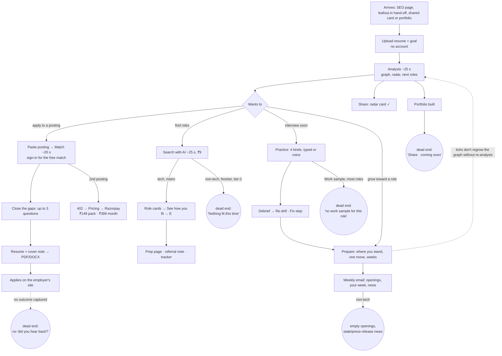

# AI feature launch audit: Leafout for Indian professionals

Date: 2026-11-03.

Every claim is tagged:
- **[V] Verified**: I ran it, against the local app on Haiku 5.5 (production's models) or read-only against app.leafout.in.
- **[R] Read-only**: inferred from code.
- **[U] Unknown**: not tested.

**Method.**
- **Personas**: eight synthetic Indian ones, each with its own posting:
  - campus B.Tech, a tier-2 college, against a TCS-NQT-style drive;
  - TCS/Infosys engineer → product SDE-2, 90-day notice;
  - CA at Big 4 → FP&A;
  - ICU nurse, Kochi → Bengaluru or the Gulf;
  - FMCG ASM → RSM;
  - senior PM → group PM;
  - mechanical → data analyst;
  - an 85-word B.Com resume.
- **Postings**: plus an injection posting.
- **Input formats**: PDF, two-column PDF, DOCX, scanned PDF and TXT.
- **What I ran**: about 60 live runs across all features, a browser walkthrough of the main path, a Sonnet 5.5 comparison, a one-prompt "ChatGPT-style" baseline, and a competitor scan.
- **Spend**: about $2.50 in total.
- **Gates**:
  - smoke 4/4 [V];
  - pytest all green, mypy strict and ruff clean [V];
  - `npm run check` fails on main, but only because `scripts/build-check.ts:169` expects `<html lang="en">` and the pages now carry `data-look` [V].

## The answer in brief

- **The idea is right, and the honesty machinery works.**
  - No run invented a number or a skill.
  - The injection posting was refused.
  - The match screen explains itself better than anything in the Indian market.
- **The paid core isn't ready.**
  - The posting match reads many resume facts wrong, so it reports false gaps.
  - The resume and cover note built on those facts are worse than what a single ChatGPT prompt gives today.
  - It doesn't need a bigger model: Sonnet 5.5 made the same misses at 25× the cost [V]. The fix is fact extraction and the cover-note writer.
- **Three features serve tech professionals in metros only**: Search with AI, the Weekly's openings and the Work sample. Everyone else gets empty screens, and nothing tells them why.
- **Two things are ready to lean on now**: Prepare and the analysis graph. Practice is close, but its judge marks good answers as failures.

## 1. Feature inventory

Readiness: 1 = broken, 5 = ship it. Cost is measured on Haiku 5.5 (₹88 = $1).

| Feature | Readiness | Verified? | Distinctiveness | Pay-worthiness | Measured latency / cost |
|---|---|---|---|---|---|
| **Analysis**: resume → cited skill graph, next roles | **4** | V (9 personas + edge cases) | Medium-high. The evidence per skill and the honest "your resume undersells X" notes are new. | Low alone. It is the free hook. | 15–31 s, ₹0.2–0.6 |
| **Chat ("Ask")** | **4** | V (7 questions, 2 traps) | Low-medium: a grounded ChatGPT that refused both fabrication traps | Low alone | 10–23 s; ₹0.1, or ₹7 with web search |
| **Portfolio** | **2** | V | Medium | Growth, not revenue | 11–16 s, ₹0.2. **Cannot be published.** |
| **Radar card** | **4** | V | Medium (README/LinkedIn image) | Growth | No model cost |
| **Posting match** | **3** | V (9 pairs + browser) | **High**: requirement-by-requirement against cited evidence, hard requirements first, "can't tell" is never a fail | **Yes, once its facts are right.** The core of a paid tier. | 9–27 s (one 97 s timeout), ₹0.5 |
| **Application kit** (resume, cover, PDF/DOCX) | **2** | V (7 kits + baseline) | High in principle; below the ChatGPT baseline today | Is what people pay for, but not in this state | 7–12 s each, about ₹1 per kit |
| **Search with AI** (Discover) | **2.5** (3 for tech in a metro; 1 for everyone else) | V (9 runs) | Medium: employer boards only, no fake jobs | Low; can't carry a tier | 9–48 s, ₹9 per run, even when it finds nothing |
| **Role prep page / referral note** | **3.5 / 3** | V | Medium | Bundle only | 2–4 s, about ₹0.05 |
| **Discover tracker** (Saved, Applied, Compare) | **3.5 feature, 2 durability** | R | Low | None | Browser storage only |
| **Prepare** (stand, one move, week plan) | **4** | V (3 plans) | Medium-high: gaps and weeks computed in code, cited | Supports a monthly tier | 10–12 s, ₹0.3–0.4 |
| **Practice the interview** | **3** | V (9 sessions + Sonnet) | Medium. apna's AI Job Prep has resume-based Hindi/Hinglish mocks at scale; Leafout wins only on "about your own work". | The second paying moment, after the judge is fixed | Turns 1–5 s, ₹0.5–1 per session |
| **Re-drill + Fix steps** | **3** | V | Medium | Bundle | Instant |
| **Speech (Sarvam)** | **2** | U (no key locally) | Low (apna has it) | Bundle | Unknown |
| **The Weekly** | **3** for tech, **1** for others | V (4 editions) | Low-medium | Retention, free | 6 s, ₹2–3 per edition |

## 2. The user journey

**The trunk** is: upload → graph → paste a posting → close gaps → kit → apply. It is short and well signposted, and the pasted posting survives the sign-in detour [V]. The graph says "Match a posting" right under the score.

**Where it breaks:**
1. **At the kit, the step people pay for** (§3, blockers 1–3).
2. **After applying, nothing comes back.** There is no "did you hear back?" and no outcome capture, so the data that "compounds" (soul) is never collected [R]. The Discover tracker is the only place an application is recorded, and it lives in browser storage [R].
3. **Every discovery branch is tech-and-metro only:** Search with AI, the Weekly's openings and the Work sample. A nurse, CA, FMCG manager or fresher hits an empty screen with no explanation [V].
4. **Portfolio** builds but can't be published, although the pricing page lists "A public portfolio page" as free [V].
5. **Sign-in** happens only through leafout.in in production (Google and email are off) [V]. An anonymous user who hits the 3-a-day cap gets a 429 that doesn't suggest signing in [V].

## 3. Launch blockers, by severity

| # | Blocker | Evidence | Effort |
|---|---|---|---|
| 1 | **The match reports false gaps because the fact book drops non-bullet resume content.** Registrations, licences, languages, notice period, CTC, certifications, articleship, marks, vehicles and relocation are never extracted. The match then says the nurse has "no KNC or INC registration" (her resume says "Indian Nursing Council registered"). It asks the CA for Power BI that her resume lists twice, and marks FMCG "MS Excel" a gap. Every persona showed it, on Haiku and Sonnet alike. | V: all 9 pairs, browser run. R: `match/facts.py` regroups only bullets and graph skills. | M–L: a "profile details" fact set at analysis |
| 2 | **The cover note isn't sendable.** All 7 of 7 had at least one of: sentence fragments ("handled annual budget of."), a third-person meta paragraph ("Smitha holds … The resume records the BLS certification as an accomplishment…"), raw fact dumps, or volunteered false negatives ("I have not yet obtained a valid nursing council registration"). Lengths were 95–185 words against a 250–400 rule; the lint flags it and the note ships anyway. | V | M: no gap paragraph by default; suppress notes that fail lint |
| 3 | **Gap answers don't improve the resume.** An answer is pasted verbatim as a skill name ("Only basic. I made a small Power BI dashboard…") and never becomes a bullet. A gate answer doesn't update the matching requirement, so the cover note still contradicts it. | V. R: `match/variant.py` `add(...)`, `api/matching.py:344` | M |
| 4 | **The Practice judge fails strong answers and passes a bluff.** About half of the specific story answers were graded "Couldn't defend"; the same answer sent 3 times gave floor, floor, push. A CA who claimed to sign audit reports "as engagement partner" was graded Defended, and the claim was **offered as a new fact for her profile**. That breaks non-negotiable 1. Re-drill then sends people back to their *best* stories as "weak". | V: 9 sessions. R: `interview/judge.py:134-165` | M: log the raw judge output; relax the verbatim-quote rule for stories; hold back newFacts the avoid line flagged |
| 5 | **No privacy policy, terms, or consent at resume upload.** `/privacy` and `/terms` are 404 on production. This is a DPDP Act 2023 exposure for an app that stores resumes with phone numbers. | V (prod GET) | S (+ counsel) |
| 6 | **Developer text and wrong labels shown to users.** Any error containing "auth" or "401" shows "Claude Code is not signed in on the server. Run: claude auth login". The analysis screen says "claude-haiku-4-5" and "Sonnet is drawing your graph" while production runs Haiku 5.5, and it shows a raw agent log. | V browser. R: `Analysis.tsx:16-17,44,493` | S |
| 7 | **Models don't know today's date.** Jul 2021–now became "about three years"; Sep 2023–now became "roughly 2 years, short of 3–6". Years-of-experience requirements, the most common hard filter in Indian postings, are misjudged. Sonnet got them right. | V. R: no date in any prompt | S: inject the date or compute years in code |
| 8 | **The pricing page sells the wrong things.** Practice, the prep plan and the radar card are marked "COMING" though live and free, so the ₹399 month visibly buys only "unlimited postings". The portfolio is listed free but can't be published. | V | S |

**Update, 2026-11-03: blockers 1–3 fixed (uncommitted).** Re-run live on Haiku 5.5 with the same personas:
- **Blocker 1 (lost facts).**
  - Resume lines no fact quoted now become cited facts: 11–24 per persona.
  - Nurse: registration moved from gap to partial; the 100+ bed and night-shift requirements to covered; all five gates pass.
  - CA: Power BI moved from gap to partial. FMCG: Excel moved from gap to partial, and Hindi is covered.
  - Bullets a PDF wrapped keep their numbers (the 1.8 s → 600 ms line).
- **Blocker 2 (cover note).** Gaps no longer enter the note. Across 4 personas there were no fragments, no third person, no "the resume" and no "I have not"; the nurse note now names the 450-bed hospital.
- **Blocker 3 (answers and gates).**
  - An answer names a skill only through the posting's own term ("Power BI"), never by its sentence.
  - Answering a gate re-checks the requirement that quotes the same sentence.
- **Not fixed:** an answer still never becomes a job bullet, because which job it belongs to has to be asked in the UI (design first). The CA's note came out short (86 words) once the bad paragraphs were refused; its length lint flags it.

**High priority, not blocking:**
- **PDF line-wrap**: wrapped bullets become fragment facts and lose their numbers ("Redesigned the dispute status API and"). It affects most real PDF resumes. [V, partly due to how the test PDFs were made]
- **Search with AI empty runs**: 4 of 5 non-tech or fresher runs returned nothing at ₹9 each. The registry is 51 tech/fintech employers, with 0 nursing listings. Lucknow is rejected as a city. The empty state promises roles "you would not find on your own". [V]
- **Goal ignored**: next roles and search ignore the stated goal (mech → data searched "Quality Engineer"; the CA's top role was "Senior Financial Controller, ~8 months"). [V]
- **Model-guessed scores**: graph scores, role alignment and ETA are model-emitted integers. The same resume swung about 6 points between runs. This is in tension with non-negotiables 2 and 8. [V/R]
- **Naukri fetched**: the analysis opened a Naukri link a user supplied, which non-negotiable 4 forbids. It failed harmlessly on a bot check. [V]
- **Weekly news**: news over 60 days old is shown undated as this week's, and ANI press releases appear as news. "Dental care" was offered as a skill gap. `.env.example` contains blocked news domains that silently kill news if copied. [V]
- **Indian amounts rejected**: `Rs. 8 crores` is refused as "not a figure we can use" (`match/bullets.py:58`). [V]
- **Shared spend ceiling**: Search with AI can drain the shared $20 daily ceiling and take every feature down. [R]
- **Cold start**: 13.4 s on the first production load. [V, once]
- **Copy and layout**: "Tayyari" still appears in server messages and payment titles. The graph header overlaps at 800 px, and the header fills about a third of a phone screen. [V]

**Update, 2026-11-05: more of the list fixed** (branch `claude/charming-ride-ojz4kd`, not deployed; unit tests only, no live run, because the session had no model key):
- **Blocker 6 (developer text).** The analysis screen names roles, never models ("Readers in progress", "Drawing your graph", "Synthesizer"), on the server and the client. The "claude auth login" hint is gone: the server has no Claude Code sign-in, and its own messages are written for people. The chat header no longer says claude-sonnet-5-5. The agent log stays, with "graph" as the synthesizer's speaker. A test fails if a phase label or log line names a model.
- **Blocker 7 (today's date).** The gate and coverage calls start with "Today's date: YYYY-MM-DD." and their system prompts say to count years to today, a role marked "present" running to today. The reader and synthesizer prompts already had the date.
- **Naukri fetched.** `ingest/boards.py` lists the boards whose terms forbid automated reading (Naukri, Indeed, Glassdoor, foundit, Shine, TimesJobs, iimjobs, hirist, Instahyre, Internshala, Unstop). The analysis refuses them before any request and on every redirect hop, and the posting match uses the same list. LinkedIn is unchanged and is now an open decision in `docs/roadmap.md`.
- **Weekly news.** An item whose date (the search result's own age first, else the model's) is over 60 days old or after tomorrow is dropped instead of shown undated. Press-release and paid-content addresses are dropped. A configured news domain the search cannot read is left out and logged instead of failing every search, and `.env.example` now shows readable domains.
- **Indian amounts.** A figure is read by the verifier's own number reader, so `Rs. 8 crores`, `INR 2.5 cr`, `₹12 lakh`, `12 LPA` and `1,20,000` are accepted. The slot keeps the person's spelling without doubling the currency or the unit (`₹[x] crore` + `Rs. 3.2 crores` reads `Rs. 3.2 crores`).

**Retracted:** the roadmap's "portfolio routes don't check the owner" is stale. GET, PATCH and rewrite return 404 to strangers [V].

## 4. Gaps and opportunities (impact ÷ effort)

**Do before launch: high impact, small effort**
1. Give every prompt today's date (blocker 7).
2. Cover note:
   - no gap paragraph unless the user asks for one;
   - never send a note that fails its own lint;
   - fall back to a short three-paragraph note.
3. Search with AI and the Weekly should say plainly who they cover ("tech and product companies, mostly Bengaluru, Pune, NCR, Hyderabad").
   - Check coverage before spending ₹9 on web searches.
   - Otherwise send people to paste a posting.
4. Fix the pricing page, hide the developer copy, publish a privacy page, and add "sign in for more" to the anonymous 429.
5. Feed the stated goal into next roles and the search brief.
6. Accept `Rs.`, `lakh` and `crore` in every format.

**The India layer: high impact, medium effort. This is the real differentiator.**
1. **One "logistics" card per person**, kept as cited "from you" facts: notice period (and buyout), current and expected CTC, relocation, languages, registrations and licences, vehicle.
   - Every Indian posting filters on these, and every Indian resume states them.
   - Use it in gates, the cover note and an HR-round practice.
   - No competitor handles notice period well, and it is the top complaint in lateral hiring.
2. **"Am I eligible?" for campus and mass drives.** The match already extracts "60% throughout", backlogs, batch, age and bond as gates [V].
   - Lift the three-question cap for gates.
   - Treat the bond as a question, not a skill gap.
   - Pair it with an aptitude and HR practice round. This is the student market the soul names.
3. **HR-round practice**: "why are you leaving", notice negotiation, CTC expectation, in English, Hindi or Hinglish. Sarvam is already wired.
4. **Work sample by the target role, not the current title** (it reaches 1 of 8 personas today).

**Bigger bets**
- **Outcome capture** after applying (heard back, interview, offer). It feeds Practice and the "data compounds" thesis.
- **Non-tech discovery** through partnerships (apna, NCS, Internshala) or employers' own careers pages with JobPosting markup. More Greenhouse boards won't reach a nurse.
- **Sonnet 5.5 for the analysis synthesizer only** (about ₹5 per analysis). It visibly fixed roles and seniority [V]. It is not worth it for match or kit (25×, same misses) [V].

**Cut or hide for launch**
- Portfolio "Share" until publishing exists.
- The Weekly's openings and news for readers they don't cover (send "your week" only).
- Work sample when there's no template.
- Search with AI for profiles outside its coverage.
- The 0–100 domain scores next to "every score rests on cited evidence". Show bands, as the soul says.

## 5. Positioning

Leafout is the only career tool in India where every line it says about you points to something you actually did, and every gap is shown instead of papered over. In a market where 87% of applicants polish resumes with AI and recruiters blame AI sameness, that is the one claim ChatGPT, Naukri's Neo and LinkedIn's match band cannot make [V competitor scan]. Charge for the moment someone has a posting they want:
- **₹149 for three postings**, each taking the posting all the way to the kit;
- **₹399 for an applying month**, bundling unlimited postings with Practice and Prepare (live today, so stop calling them "coming").

Keep the graph, the radar card and one posting a month free, since they are the acquisition engine. A heavy pass user costs about ₹190 a month against ₹328 net [V/R]. A pack costs about ₹3 against ₹123 [V]. Pricing isn't the risk; kit quality is. Don't open payments until blockers 1–3 are fixed, because the first paid kit is the review people will repeat.

## 6. Open questions for you

1. **Who is launch day for?** If it's tech professionals in metros, Search with AI and the Weekly can stay. If it's "Indian professionals" broadly, hide them for others or say what they cover.
2. **Do you want the logistics card (notice, CTC, registrations, languages)?** It's my strongest India-specific recommendation, and it touches analysis, match, kit and Practice.
3. **Prices.** Production has ₹149 and ₹399; your research recommended ₹199 and ₹599. Is ₹399 deliberate?
4. **Scores.** Keep the 0–100 domain and mastery numbers, or move the graph to bands as the soul says?
5. **The Sonnet synthesizer** at about ₹5 an analysis: acceptable for everyone, or only for paid users?
6. **Legal.** Who writes the privacy policy and terms (DPDP), and is there a data-deletion promise to show at upload?
7. **Hindi/Hinglish Practice.** apna already ships it at scale. Is it a launch requirement for you?

## What I could not verify

- Sarvam speech quality and cost.
- Weekly email delivery and unsubscribe (Resend is off locally).
- Production behaviour beyond read-only GETs.
- ₹ and Indic glyphs in the Helvetica-only PDFs.
- Why the Practice judge fails answers (the raw judge output isn't logged).
- The cold start (one observation).

Raw outputs, scripts and the eight personas are in the session scratchpad (`audit/`), not in the repo.
